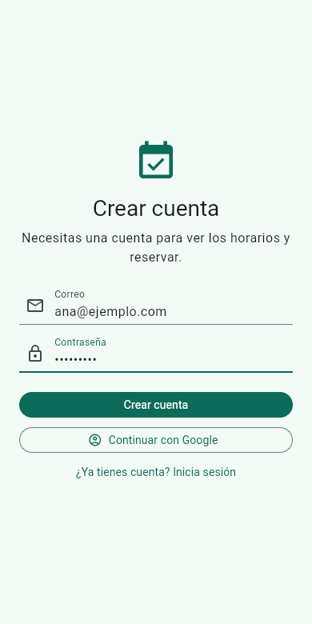
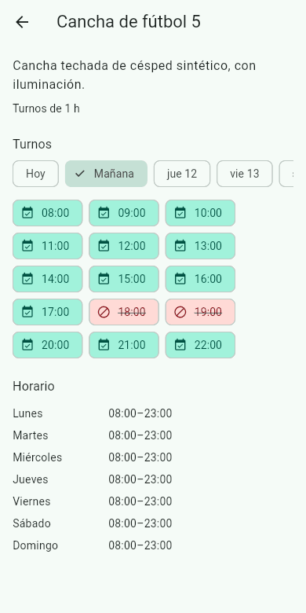
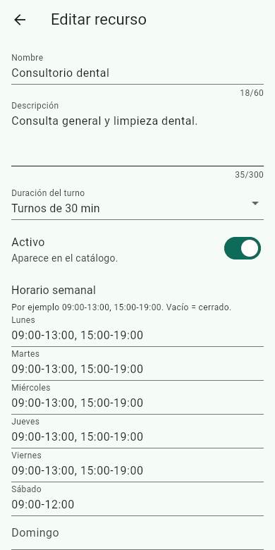
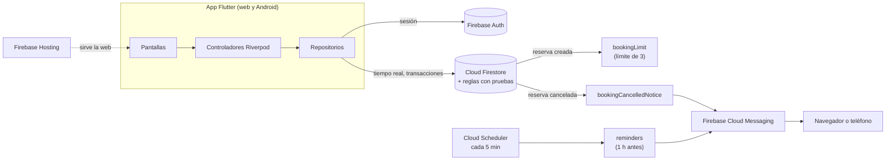

# Turnos — App de reservas con Flutter y Firebase

[](https://github.com/rolandocesar-prog-dev/turnos-app-flutter/actions/workflows/ci.yml)

App para que canchas, consultorios y otros negocios con agenda publiquen sus horarios y sus
clientes reserven, cancelen y reciban recordatorios, **sin reservas duplicadas**.

**Versión web:** https://turnos-rv-portafolio.web.app



_Demo grabada contra los emuladores de Firebase con los datos de ejemplo (`npm run seed`)._

## Qué hace

| Catálogo | Franjas en tiempo real | Mis reservas |
| --- | --- | --- |
|  |  |  |

| Formulario de recurso | Reservas del día |
| --- | --- |
|  |  |

**Cliente**

- Cuenta con correo y contraseña (y Google en la web).
- Catálogo de lugares y franjas de los próximos 7 días, actualizadas en tiempo real: disponible,
  ocupada o pasada, con texto e ícono y no solo con color.
- Reservar con confirmación. Si dos personas reservan la misma franja a la vez, solo una lo logra
  y la otra recibe «Ese horario acaba de ocuparse».
- Hasta 3 reservas activas; se puede cancelar hasta 2 horas antes.
- Avisos push: recordatorio 1 hora antes y aviso si el negocio cancela.

**Negocio (administrador)**

- Crear, editar y desactivar lugares, con horario semanal («09:00-13:00, 15:00-19:00») y días
  bloqueados.
- Reservas del día de todos los clientes y cancelación con un motivo que el cliente ve.

## Arquitectura



- **Por funcionalidad y por capas**: `features/<x>/{domain,data,application,presentation}`. El
  dominio no importa Flutter ni Firebase; se prueba con pruebas unitarias puras.
- **Sin doble reserva**: cada franja tiene un id determinista (`recurso + fecha y hora`). Reservar
  es una transacción que crea la franja y la reserva juntas, y las reglas solo dejan **crear** una
  franja que no existe.
- **Las reglas de Firestore son el control real** (41 pruebas en el emulador): cada cliente lee
  solo lo suyo, la reserva debe ser futura según la hora del servidor, cancelar exige 2 horas de
  anticipación y liberar la franja en el mismo lote.
- **Lo que las reglas no pueden hacer, lo hace el servidor**: las reglas no cuentan documentos, así
  que una Cloud Function cancela la cuarta reserva activa de un cliente modificado; el orden por
  `createdAt` hace que dos reservas simultáneas terminen siempre igual.
- **Recordatorios**: una función programada marca el recordatorio en una transacción antes de
  enviar (nunca llegan dos) y escribe la hora en la zona del negocio, no en la del servidor.
- **Emuladores en desarrollo y CI**: todo se desarrolla y prueba contra los emuladores con el
  proyecto `demo-turnos`, sin tocar datos reales.

El detalle está en [`specs/design.md`](./specs/design.md).

## Calidad

| Qué | Cómo | Cantidad |
| --- | --- | --- |
| Dominio y pantallas | `flutter test`: unitarias y de widgets con repositorios simulados | 173 |
| Accesibilidad | Contraste AA, áreas táctiles, botones con nombre (tema claro y oscuro) y texto al 200 % | 7 pantallas |
| Reglas de Firestore | `@firebase/rules-unit-testing` en el emulador | 41 |
| Cloud Functions | Vitest: lógica pura y disparadores reales en el emulador | 14 + 8 |
| Integración | `flutter drive` en Chrome contra los emuladores: crear cuenta, reservar y cancelar | 1 flujo |

El CI corre todo en cada push. Varias pruebas tienen **control**: se aflojó a propósito la regla o
el código que protegen y se comprobó que fallaban.

Textos en español en `lib/l10n/app_es.arb` (`gen-l10n`), listos para sumar otros idiomas.

## Stack

Flutter 3.47 (fijado con FVM) · Dart · Riverpod 3 · go_router · Firebase (Auth, Firestore, Cloud
Functions 2.ª gen. en TypeScript, Cloud Messaging, Hosting) · Vitest · GitHub Actions

## Cómo correrlo

La versión de Flutter está fijada en `.fvmrc` y se usa con [FVM](https://fvm.app). En Windows, FVM
necesita el Modo de desarrollador activado. Los emuladores necesitan Java 11 o superior y Node.js.

```bash
fvm install
npm ci && npm ci --prefix functions
npm run emulators      # compila las funciones; Auth :9099, Firestore :8080, interfaz :4000
```

En otra terminal:

```bash
npm run seed           # recursos de ejemplo y cuenta de administrador
fvm flutter run -d chrome
```

La cuenta de administrador de los datos de ejemplo es `admin@turnos.test` con la contraseña
`admin-turnos`; solo existe en los emuladores. Cualquier otra cuenta que crees es de cliente.

Calidad, lo mismo que corre el CI:

```bash
fvm dart format --output=none --set-exit-if-changed .
fvm flutter analyze
fvm flutter test
npm run test:rules        # reglas de Firestore en su propio emulador
npm run test:functions    # funciones en los emuladores de Functions y Firestore
```

La prueba de integración (`npm run test:e2e`) levanta sus propios emuladores y necesita un
[chromedriver](https://googlechromelabs.github.io/chrome-for-testing/) de la versión de tu Chrome
en el puerto 4444 (en local: `FLUTTER="fvm flutter" npm run test:e2e`).

### Proyecto real

```bash
fvm flutter run -d chrome --dart-define=FIREBASE_ENV=production
FLUTTER="fvm flutter" npm run deploy:hosting   # compila para production y publica la web
npm run deploy:firestore                       # reglas e índices
npm run deploy:functions                       # funciones (plan Blaze)
```

Las opciones de `lib/firebase_options.dart` no son secretas: identifican el proyecto. Los datos los
protegen las reglas. En el proyecto real nadie es administrador al empezar: se crea la cuenta en la
app y se cambia `role` a `"admin"` en `users/{uid}` desde la consola.

## Estado

Hitos M0 a M5 en [`specs/tasks.md`](./specs/tasks.md). Pendiente por decisión: publicar la app de
Android en prueba interna de Google Play (la demo pública es la versión web). El acceso con Google
en el proyecto real se activa compilando con `--dart-define=GOOGLE_SIGN_IN=true`.

## Cómo se desarrolla

**Spec Driven Development**: [`requirements.md`](./specs/requirements.md) (qué, con criterios
EARS), [`design.md`](./specs/design.md) (cómo y por qué) y [`tasks.md`](./specs/tasks.md) (plan
por hitos). Ningún código sin un requisito que lo respalde.

## Licencia

[MIT](./LICENSE)
